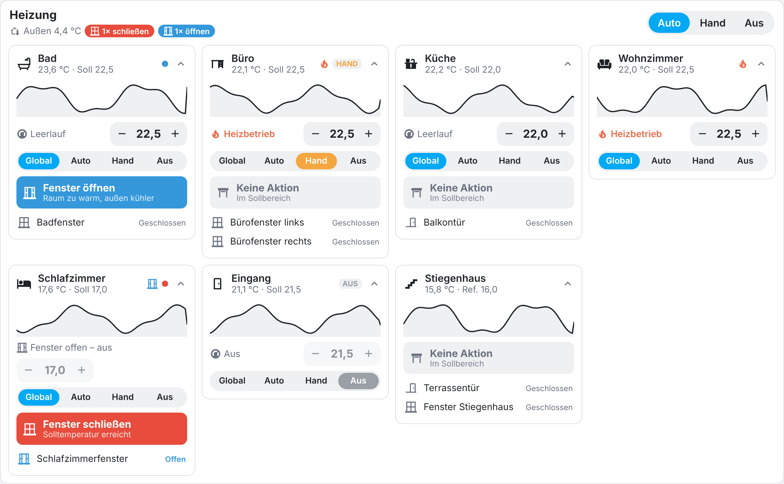
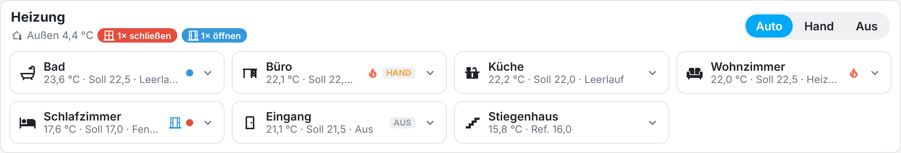
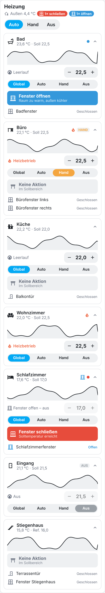
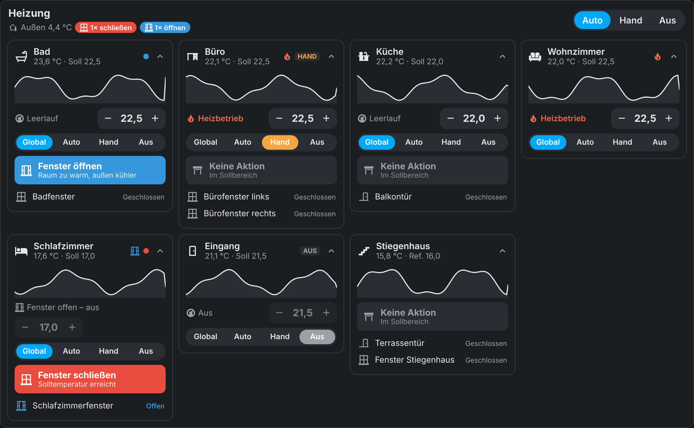
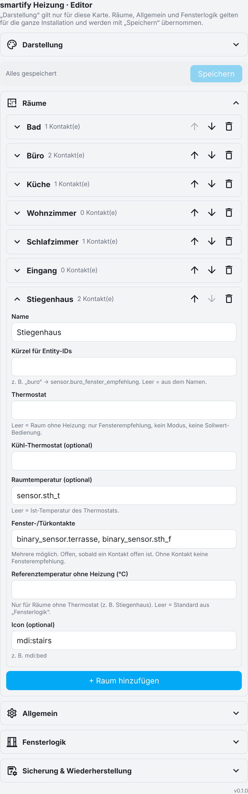
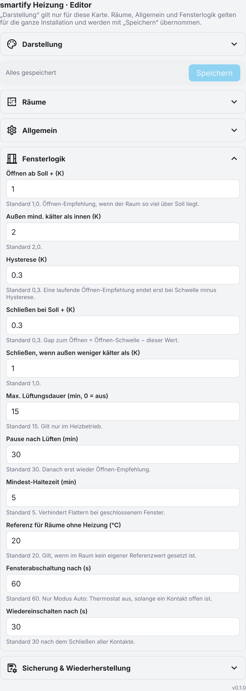

# smartify Heizung

Home-Assistant-Integration mit eigener Karte für die Raumregelung:

- **Modus gesamt** Auto / Hand / Aus und **je Raum** Global / Auto / Hand / Aus
- **Fensterabschaltung** im Modus Auto: Thermostat aus, solange ein Kontakt offen ist
- **Fensterempfehlung** öffnen / schließen / keine Aktion, mit Gap und Hysterese
- **Mehrere Fensterkontakte pro Raum**
- **Räume ohne Heizung** (z. B. Stiegenhaus): nur Fensterempfehlung
- Karte im smartify-Stil mit **einklappbaren Räumen** und einem Editor mit einklappbaren Bereichen



Die Logik läuft im Backend, also auch ohne geöffnetes Dashboard. Die Integration liefert die Karte selbst aus und registriert die Lovelace-Ressource automatisch; nichts muss nach `www/` kopiert werden.

## Inhalt

- [Installation](#installation)
- [Karte](#karte)
- [Modi](#modi)
- [Fensterempfehlung](#fensterempfehlung)
- [Räume ohne Heizung](#räume-ohne-heizung)
- [Editor](#editor)
- [Entitäten](#entitäten)
- [Kartenoptionen (YAML)](#kartenoptionen-yaml)

## Installation

1. HACS → ⋮ → **Benutzerdefinierte Repositories** → `https://github.com/smartify-your-home/smartify-heating`, Kategorie **Integration**
2. **smartify Heizung** installieren und Home Assistant neu starten
3. Einstellungen → Geräte & Dienste → **Integration hinzufügen** → *smartify Heizung*
4. Dashboard bearbeiten → **Karte hinzufügen** → *smartify Heizung*
5. In der Karte unter **Räume** die Räume anlegen und **Speichern** drücken

Bei Lovelace-Ressourcen im YAML-Modus muss die Ressource einmal manuell eingetragen werden:
`/smartify_heating/smartify-heating-card.js` (Typ `module`).

## Karte

Jeder Raum zeigt Temperaturverlauf, Ist-/Sollwert mit Bedienung, Raummodus, Fensterempfehlung und alle Kontakte. Oben stehen Gesamtmodus, Außentemperatur und eine Zusammenfassung der Empfehlungen.

Räume lassen sich per Klick auf den Kopf **einklappen**. Der Zustand wird je Browser gemerkt. Im eingeklappten Zustand bleiben Ist/Soll, Heizbetrieb, Modus, ein offenes Fenster und die Empfehlung (als Punkt) sichtbar:



<table>
<tr>
<td width="36%"></td>
<td></td>
</tr>
<tr><td align="center">Smartphone</td><td align="center">Dunkles Theme</td></tr>
</table>

## Modi

| Modus | Wirkung auf das Thermostat |
|---|---|
| **Auto** | Thermostat an, regelt selbst. Fensterabschaltung aktiv. |
| **Hand** | Thermostat an, keine Fensterabschaltung. |
| **Aus** | Thermostat aus. |
| **Global** (nur Raum) | Raum folgt dem Gesamtmodus. |

- Ein globales **Aus** übersteuert alle Räume. Globales Auto/Hand gilt für Räume auf „Global“.
- Der Modus wird **nur beim Wechsel** auf das Thermostat geschrieben (und einmal beim Start). Ein manueller Eingriff am Thermostat bleibt danach bestehen.
- **Fensterabschaltung:** Ist ein Kontakt 60 s offen, wird das Thermostat ausgeschaltet. 30 s nachdem alle Kontakte zu sind, wird es wieder eingeschaltet. Im Raum steht dann „Fenster offen – aus“.
- Geschaltet werden nur die Raum-Thermostate, **nicht** die Wärmepumpe bzw. der Heizkreis.

## Fensterempfehlung

Basis: Raumtemperatur (Sensor oder Ist-Wert des Thermostats), Soll (Thermostat oder Referenzwert) und Außentemperatur.

| Empfehlung | Bedingung (Standardwerte) |
|---|---|
| **öffnen** | Fenster zu **und** Ist ≥ Soll + 1,0 K **und** außen mindestens 2,0 K kälter als innen |
| **schließen** | Fenster offen **und** (Ist ≤ Soll + 0,3 K **oder** außen weniger als 1,0 K kälter **oder** 15 min offen) |
| **keine Aktion** | alles dazwischen |

- **Gap:** Öffnen erst ab +1,0 K, schließen bei +0,3 K. Dazwischen bleibt ein offenes Fenster ohne Meldung offen.
- **Hysterese 0,3 K:** Eine laufende Öffnen-Empfehlung endet erst bei +0,7 K bzw. 1,7 K Außendifferenz.
- **Haltezeit 5 min** bei geschlossenem Fenster gegen Flattern. Schließ-Empfehlungen kommen sofort.
- **Max. Lüftungsdauer 15 min**, danach **30 min Pause** ohne neue Öffnen-Empfehlung. Im Kühlbetrieb ist das Limit aus.
- **Mehrere Kontakte:** Ein Raum gilt als offen, sobald ein Kontakt offen ist.
- Räume ohne Kontakt bekommen keine Empfehlung.

Der Grund steht in der Karte unter der Empfehlung und im Attribut `grund` (`zu_warm`, `im_soll`, `soll_erreicht`, `aussen_zu_warm`, `lueftungsdauer`, `lueften_ok`, `pause_nach_lueften`, `haltezeit`, `sensorwert_fehlt`).

## Räume ohne Heizung

Bleibt beim Raum das Feld **Thermostat** leer, ist es ein Raum ohne Heizung (z. B. Stiegenhaus, Abstellraum):

- nur Fensterempfehlung und Fensterkontakte
- kein Raummodus, keine Sollwert-Bedienung, keine Fensterabschaltung
- Gesamtmodus Aus wirkt nicht auf die Empfehlung
- Bezugswert ist die **Referenztemperatur** des Raums. Ist sie leer, gilt der Standard aus *Fensterlogik* (20 °C). Die Karte zeigt ihn als „Ref.“.

## Editor

Alle Bereiche sind einklappbar. **Darstellung** gilt nur für diese Karte. **Räume**, **Allgemein** und **Fensterlogik** gelten für die ganze Installation; sie werden mit **Speichern** übernommen (nur für Administratoren). Danach werden die Entitäten automatisch angelegt bzw. entfernt.

<table>
<tr>
<td width="50%"></td>
<td width="50%"></td>
</tr>
<tr><td align="center">Räume</td><td align="center">Fensterlogik</td></tr>
</table>

In Home Assistant erscheinen statt der Textfelder die normalen Entitäts-Auswahlfelder. Unter **Sicherung & Wiederherstellung** lässt sich die gesamte Konfiguration als JSON exportieren und importieren.

**Je Raum:** Name, Kürzel für die Entity-IDs, Thermostat, optional Kühl-Thermostat, Raumtemperatursensor (für den Verlauf), beliebig viele Fenster-/Türkontakte, Referenztemperatur ohne Heizung und Icon.

**Allgemein:** Außentemperatur, optional ein Kühlbetrieb-Schalter. Ist er an, werden die Kühl-Thermostate genutzt und das Lüftungsdauer-Limit entfällt.

## Entitäten

Das Präfix ist das **Kürzel** des Raums.

| Entität | Inhalt |
|---|---|
| `select.heizung_modus` | Modus gesamt |
| `select.<kürzel>_heizmodus` | Raummodus (nur Räume mit Heizung); Attribute `wirksamer_modus`, `fensterabschaltung` |
| `sensor.<kürzel>_fenster_empfehlung` | `oeffnen` / `schliessen` / `keine_aktion`; Attribute `grund`, `innen`, `soll`, `aussen`, `offen_seit`, `pause_bis` |
| `binary_sensor.<kürzel>_fenster_offen` | an, sobald ein Kontakt offen ist |
| `sensor.fenster_empfehlung_gesamt` | `schliessen` vor `oeffnen` vor `keine_aktion`; Attribute mit Raumnamen |

Bestehen schon Entitäten mit denselben IDs (z. B. alte Template-Sensoren), hängt Home Assistant `_2` an. Darum die alten Sensoren vorher entfernen.

Beispiel-Automation:

```yaml
triggers:
  - trigger: state
    entity_id: sensor.fenster_empfehlung_gesamt
    to: schliessen
    for: "00:02:00"
actions:
  - action: notify.notify
    data:
      message: "Fenster schließen: {{ state_attr('sensor.fenster_empfehlung_gesamt', 'schliessen') | join(', ') }}"
```

## Kartenoptionen (YAML)

```yaml
type: custom:smartify-heating-card
title: Heizung
show_header: true          # Gesamtmodus, Außentemperatur, Zusammenfassung
columns: 0                 # 0 = automatisch
min_column_width: 220      # px, bei automatischen Spalten
collapsible: true          # Räume ein-/ausklappbar
start_collapsed: false
show_graph: true           # Verlauf aus dem Raumtemperatursensor
hours_to_show: 24
show_controls: true        # Sollwert −/+
show_mode: true            # Global/Auto/Hand/Aus je Raum
show_recommendation: true
hide_no_action: false      # „Keine Aktion“ ausblenden
show_windows: true
rooms: []                  # Raum-IDs zur Auswahl/Reihenfolge, leer = alle
```

Mehrere Karten (z. B. je Stockwerk) zeigen mit `rooms` jeweils eine Auswahl derselben Räume.

## Entwicklung

```bash
python scripts/check_version.py            # Manifest, Card und CHANGELOG gleich
python -m unittest discover -s tests       # Logik
node tests/test_card.cjs                   # Card
pip install pytest-homeassistant-custom-component pytest-asyncio
PYTHONPATH=. python -m pytest tests_ha --asyncio-mode=auto   # Integration mit HA-Core
```

Die Screenshots zeigen Testdaten.
